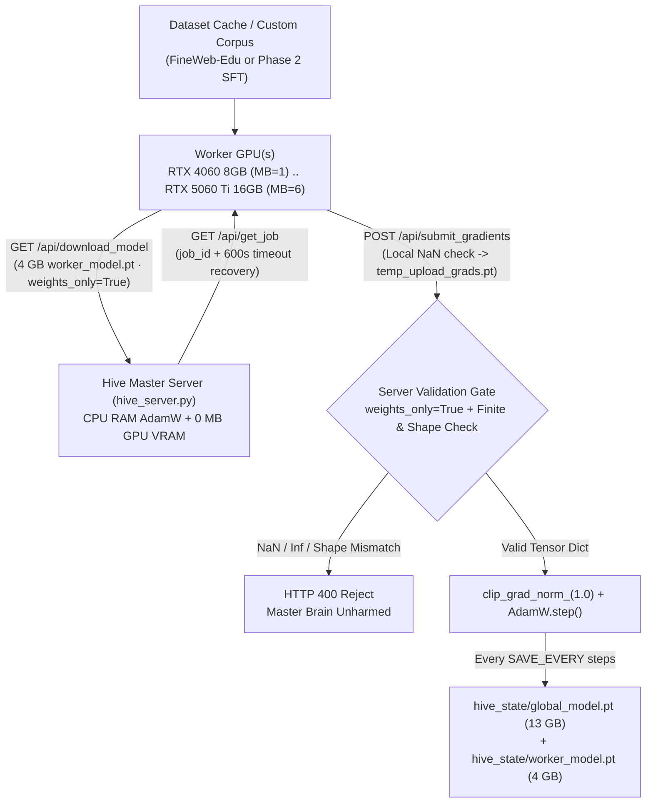

# Spectra Mythos Hive

[](https://github.com/Creator-NL/SpectraMythosHive/actions/workflows/ci.yml)
[](LICENSE)
[](https://www.python.org/downloads/)
[](https://biohazard-corp.nl/openmythos)

**Train dedicated 1-billion-parameter Recurrent-Depth Mixture-of-Experts (`OpenMythos 1B`) AI models from scratch on consumer GPUs — solo or pooled with friends over HTTP.**

* **Website & Flagship Showcase:** [biohazard-corp.nl/openmythos](https://biohazard-corp.nl/openmythos)
* **Architecture Foundation:** Powered by [OpenMythos](OpenMythos/README.md) by Kye Gomez (`The-Swarm-Corporation/OpenMythos`, MIT License)

---

## Why This Exists

Most 1B+ LLM training repositories assume multi-GPU data center nodes (`torchrun` across 8× H100s). **Spectra Mythos Hive** splits training cleanly between a **CPU Master Server** and **Consumer GPU Workers**:

* **Hive Server (`hive_server.py`)** keeps master `OpenMythos 1B` weights and the `AdamW` optimizer in system RAM (**0 MB GPU VRAM used by the server**), tracks distributed jobs with timeout recovery (`600s`), rejects `NaN`/`Inf` gradient corruption (`HTTP 400`), loads network payloads strictly via `weights_only=True`, clips gradient norms (`1.0`), and serves a stripped **4 GB** weights-only checkpoint (`worker_model.pt`) instead of the full **13 GB** optimizer checkpoint.
* **Hive Workers (`hive_worker.py` / `hive_worker_phase2.py`)** load weights into CPU RAM first (`map_location="cpu"`) before streaming into VRAM in `bfloat16`, auto-size parallel batching based on your GPU's VRAM, accumulate gradients locally across micro-batches, and upload clean gradient dicts back to your Hive.

### Train Anything — One Blueprint, Endless Specialist Models

Starting from pure random static (`Loss 10.84`), **what a Hive becomes depends entirely on what you teach it**. You can run clean, separate Hive instances to build dedicated 1B models for completely different tasks:

* **STEM, Science & Medical Tutors** (Biology, physics, lab documentation, structured study)
* **Engineering, Code & Security Models** (Python, C++, CUDA, packet/firewall forensics)
* **Robotics, Domain & Local Tool Assistants** (Smart-home workflows, technical manuals, private knowledge)
* **Interactive Storytellers & Companions** (e.g., Biohazard Corp's flagship *Gravity Junior* run, proving home hardware can reach Sub-4.0 / 5-Star Science mastery)
* **Multilingual Experiments** (Exploiting the tied `50,257 × 2,048` Input/Output Door over a shared `2,048`-D Semantic Layer)

---

## Architecture Flow



---

## GPU & Hardware Compatibility (Yes, RTX 4060 8 GB Works!)

You do **not** need an RTX 50-series card or 16 GB VRAM to run a Hive Worker.

When `HIVE_MICRO_BATCH=auto` (the default), `hive_common.py` automatically detects your GPU's VRAM and selects a safe batch size:

| GPU Tier | Example Cards | Auto `MICRO_BATCH` | Approximate Worker VRAM | Notes |
| :--- | :--- | :---: | :---: | :--- |
| **8 GB VRAM** | **RTX 4060**, RTX 3060 Ti, RTX 3070 | `1` | ~4.5 – 5.5 GB | Tested on RTX 4060 8 GB (`bfloat16` + CPU checkpoint staging prevents 8 GB OOM) |
| **10–12 GB VRAM** | RTX 3060 12 GB, RTX 4070, RTX 3080 | `2` | ~6.5 – 8.5 GB | Balanced parallel throughput |
| **16 GB+ VRAM** | **RTX 5060 Ti 16 GB**, RTX 4080, 3090, 4090 | `6` | ~11.0 – 13.0 GB | High-throughput parallel reading (`6 × 256` tokens/micro-batch) |

* **Hive Server Host RAM:** Keep **24–32 GB system RAM** recommended on the server PC so the ~13 GB `global_model.pt` (`weights + fp32 AdamW moments`) stays comfortably in memory. A dedicated GPU is **not** required on the server PC.
* **Lightweight Workers Tested:** Verified syncing cleanly even over Wi-Fi on an older laptop with 8 GB system RAM.
* **Pre-Ampere GPUs (RTX 20-series / GTX 16-series):** Automatically fall back from `bfloat16` to `float16`, though RTX 30/40/50 cards with native `bfloat16` are strongly recommended for numerical stability when training from random initialization.

---

## Repository Structure

```text
SpectraMythosHive/
├── .github/
│   ├── ISSUE_TEMPLATE/           # Bug report & feature request forms
│   ├── workflows/ci.yml          # Windows + Linux syntax & CPU guardrail tests
│   ├── FUNDING.yml
│   └── PULL_REQUEST_TEMPLATE.md
├── OpenMythos/                   # Bundled MIT-licensed OpenMythos 1B model (Kye Gomez)
├── Tools/
│   ├── eval_mythos.py            # 10-domain 5-star report card & live text sampler
│   ├── checkpoint_diff.py        # Layer-by-layer L2 movement diff inspector
│   ├── plot_training_log.py      # Micro-batch & job-average loss curve plotter
│   ├── Eval_mythos.bat           # Windows one-click evaluation launcher
│   └── mythos_training_visibility_guide.md
├── docs/
│   ├── PRIVACY.md                # Zero telemetry & network transparency policy
│   └── SECURITY.md               # Security reference (canonical at /SECURITY.md)
├── tests/
│   └── test_hive_smoke.py        # CPU smoke & guardrail unit test suite
├── hive_common.py                # Shared config, VRAM auto-tuning, weight loading & worker loop
├── hive_server.py                # FastAPI CPU Master Server & AdamW Coordinator
├── hive_worker.py                # Phase 1 Worker (FineWeb-Edu pre-training)
├── hive_worker_phase2.py         # Phase 2 Worker (Instruction / Companion SFT template)
├── test_model.py                 # Interactive Phase 1 text completion tester
├── test_model_phase2.py          # Interactive Phase 2 chat tester
├── setup.bat                     # Windows venv & CUDA PyTorch installer
├── StartHive.bat                 # Launch Hive Server
├── StartWorker - phase1.bat      # Launch Phase 1 Worker
├── StartWorker - phase2.bat      # Launch Phase 2 Worker
├── StartModelTester - phase1.bat # Launch Phase 1 Tester
├── StartModelTester - Phase2.bat # Launch Phase 2 Tester
├── ACCESSIBILITY.md
├── CODE_OF_CONDUCT.md
├── CONTRIBUTING.md
├── LICENSE
├── SECURITY.md
├── requirements.txt
├── .env.example
├── .gitattributes
└── .gitignore
```

> **Note on `venv/` and `hive_state/`:** Neither the Python virtual environment nor `.env` nor multi-GB `.pt` checkpoints are committed to Git. `setup.bat` builds your local `venv/` cleanly, and `hive_server.py` initializes `hive_state/` on first launch.

---

## Quick Start (Windows)

### 1. Create Environment & Install CUDA PyTorch

Double-click **`setup.bat`** (or run it in a terminal) and pick your hardware option:
* Option **`1`**: NVIDIA RTX 20 / 30 / 40 series (including **RTX 4060**) — installs PyTorch **CUDA 12.6**
* Option **`2`**: NVIDIA RTX 50 series / Blackwell (including **RTX 5060 Ti**) — installs PyTorch **CUDA 12.8** *(if your driver/Blackwell card requires an even newer CUDA build, install the latest PyTorch CUDA nightly before `pip install -r requirements.txt`)*
* Option **`3`**: CPU-only — for a server-only machine without an NVIDIA GPU

Edit the generated **`.env`** file to set a strong `HIVE_PASSWORD`, your `WORKER_NAME`, and `HIVE_URL` (`http://127.0.0.1:8000` on the same PC, or the host's LAN/VPN IP for friend workers).

<details>
<summary>Manual Setup (Windows / Linux)</summary>

```bash
python -m venv venv
# Windows: venv\Scripts\activate
# Linux:   source venv/bin/activate

python -m pip install --upgrade pip
# Install CUDA PyTorch FIRST (example for CUDA 12.6; use cu128 for RTX 50-series):
pip install torch --index-url https://download.pytorch.org/whl/cu126
pip install -r requirements.txt

cp .env.example .env
```

</details>

### 2. Start Your Own Hive Server (From Scratch)

Run **`StartHive.bat`** (or `python hive_server.py`).

On first launch, it initializes a fresh **OpenMythos 1B** (`vocab_size=50257`, `max_seq_len=256`, 2 Prelude + Recurrent MoE Block with 2 Shared / 64 Routed Experts + 2 Coda) in system RAM and saves:
* `hive_state/global_model.pt` (~13 GB master weights + `AdamW` optimizer + job state)
* `hive_state/worker_model.pt` (~4 GB weights-only file downloaded by workers)

### 3. Connect One or More Workers (Phase 1 Pre-Training)

Run **`StartWorker - phase1.bat`** (or `python hive_worker.py`).

* The first run caches `HuggingFaceFW/fineweb-edu` (`sample-10BT`, ~27 GB) locally into Hugging Face's cache directory (`~/.cache/huggingface/datasets`) and shuffles the ~9.6M articles uniquely per worker & session so restarts never get stuck re-reading the same opening articles.
* Each job runs `HIVE_GRAD_ACCUM` micro-batches (`128` default), checks for `NaN`/`Inf`, uploads tensor gradients to the Hive Server, and merges into the master weights.

### 4. Inspect Progress & Talk to Your Model

* **Interactive Completion Test:** Run **`StartModelTester - phase1.bat`** (`python test_model.py`).
* **10-Domain 5-Star Report Card + Live Samples:** Run **`Tools\Eval_mythos.bat`** (or `python Tools/eval_mythos.py`).
* **Compare Two Saved Checkpoints Layer-by-Layer:**
  ```bash
  python Tools/checkpoint_diff.py path/to/older.pt hive_state/worker_model.pt --top 40
  ```
* **Plot Training Curves:**
  ```bash
  python Tools/plot_training_log.py training.log
  ```

---

## Console Notes & Known Honest Warnings

### Why does the worker log show `Token indices sequence length is longer than the specified maximum sequence length... (3148 > 1024)`?

When `hive_worker.py` first tokenizes a long article with `GPT2TokenizerFast(..., truncation=False)`, Hugging Face prints its standard notice whenever a raw article exceeds GPT-2's default `1024` warning threshold:

```text
[transformers] Token indices sequence length is longer than the specified maximum sequence length for this model (3148 > 1024). Running this sequence through the model will result in indexing errors
```

We deliberately **do not suppress or hide this log** so contributors have transparent visibility into tokenizer behavior:
* Right after tokenization, `hive_worker.py` slices `token_buffer` into fixed `SEQ_LEN` windows (`256` tokens by default) before stacking tensors.
* Your `OpenMythos` model therefore only ever receives `256`-token chunks and will **not** experience indexing errors.

---

## About Phase 2 (`hive_worker_phase2.py`)

Once Phase 1 base comprehension plateaus, **`hive_worker_phase2.py`** and **`test_model_phase2.py`** are included as a ready-to-customize SFT / conversational fine-tuning template formatted with `<|system|>`, `<|user|>`, and `<|ai|>` tags (`tatsu-lab/alpaca` by default, configurable via `HIVE_PHASE2_DATASET` and `HIVE_SYSTEM_PROMPT` in `.env`).

> Phase 1 (`hive_server.py` + `hive_worker.py`) is the heavily battle-tested pre-training pipeline; Phase 2 uses the same forward/backward gradient sync loop and is included as a starting template for custom dialogue or domain-specialization datasets.

---

## Key Engineering Lessons Baked In

1. **CPU Checkpoint Staging (`map_location="cpu"`):** Prevents loading a 4 GB checkpoint dict straight onto CUDA alongside an already-allocated model—critical for fitting inside **8 GB** cards like the **RTX 4060**.
2. **No-Skip Wraparound Fix:** Streaming `.skip(global_step * 8192)` wrapped back to article #0 once offsets exceeded dataset length; local disk caching + per-worker `dataset.shuffle(seed=...)` ensures true variety across millions of tokens.
3. **NaN/Inf Shield + Gradient Clipping (`1.0`):** Discards overflowing jobs on both worker and server sides before poisoned math can wipe out days of training.
4. **Precision Autocast During Generation:** Evaluators and testers wrap `model.generate()` in `torch.amp.autocast` so ACT's `float` remainder math integrates cleanly with `bfloat16` Coda layers.
5. **Hardened Network Tensor Loading:** Server gradient uploads and worker downloads use `torch.load(..., weights_only=True)` (see [`SECURITY.md`](SECURITY.md)).

---

## Community, Privacy & Security

* [Security Policy](SECURITY.md) — `weights_only=True` enforcement, poison checks & vulnerability disclosure
* [Privacy & Network Transparency](docs/PRIVACY.md) — zero Biohazard Corp telemetry; Hugging Face cache & local Hive sync details
* [Contributing Guidelines](CONTRIBUTING.md) — setup, tests (`python -m unittest discover -s tests -v`), and PR checklist
* [Code of Conduct](CODE_OF_CONDUCT.md) — Contributor Covenant v2.1 (`contact@biohazard-corp.nl`)
* [Accessibility Statement](ACCESSIBILITY.md) — UTF-8 console & accessible documentation standards

---

## Credits & Licenses

* **Spectra Mythos Hive (`hive_server.py`, workers, shared runtime, diagnostics):** MIT License — Copyright (c) 2026 **Biohazard Corp (`Creator-NL`)** ([LICENSE](LICENSE)).
* **OpenMythos Architecture (`OpenMythos/`):** Theoretical reconstruction of the Recurrent-Depth Transformer + MoE + MLA architecture by **Kye Gomez / The Swarm Corporation** ([OpenMythos/LICENSE](OpenMythos/LICENSE), MIT License).
